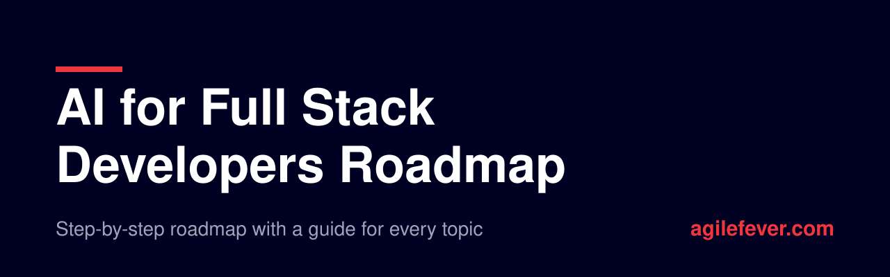

# AI for Full Stack Developers Roadmap

> AI for Full Stack Developers Roadmap - A step-by-step roadmap to write, review, test, document and debug faster with Gen AI and Agentic AI, while keeping ownership of the code, with a blog for every topic

## Table of Contents

- [Who is a Full Stack Developer in the AI Era?](#who-is-a-full-stack-developer-in-the-ai-era)
- [How to Use This Roadmap](#how-to-use-this-roadmap)
- [Step 0: Must Know](#step-0-must-know)
- [Step 1: Gen AI Basics for Developers](#step-1-gen-ai-basics-for-developers)
- [Step 2: Prompt Engineering and Context Engineering](#step-2-prompt-engineering-and-context-engineering)
- [Step 3: AI in the Developer Workflow](#step-3-ai-in-the-developer-workflow)
- [Step 4: Owning the Code AI Writes](#step-4-owning-the-code-ai-writes)
- [Step 5: Frontend Component Generation](#step-5-frontend-component-generation)
- [Step 6: Backend Logic, APIs and Databases](#step-6-backend-logic-apis-and-databases)
- [Step 7: Technical Documentation](#step-7-technical-documentation)
- [Step 8: AI Agents and Tool Use](#step-8-ai-agents-and-tool-use)
- [Step 9: Code Review, Security and Standards](#step-9-code-review-security-and-standards)
- [Step 10: Testing and Test Automation](#step-10-testing-and-test-automation)
- [Step 11: Debugging and Root Cause Analysis](#step-11-debugging-and-root-cause-analysis)
- [Step 12: Career Path Beyond Full Stack](#step-12-career-path-beyond-full-stack)
- [Step 13: Certification and Next Steps](#step-13-certification-and-next-steps)
- [Learn This Roadmap with a Mentor](#learn-this-roadmap-with-a-mentor)
- [License](#license)

### Prepared and maintained by [AgileFever](https://agilefever.com)

### Follow AgileFever

- [LinkedIn](https://www.linkedin.com/company/agilefever/)
- [YouTube](https://www.youtube.com/@AgileFever)
- [X/Twitter](https://x.com/agilefever)
- [Website](https://agilefever.com)

## Learn with AgileFever

- [Gen AI and Agentic AI for Full Stack Developers](https://agilefever.com/generative-ai/gen-ai-agentic-ai-for-full-stack-developers/)

---

> **Note: We keep updating this roadmap with new topics and blogs.**

---

### Who is a Full Stack Developer in the AI Era?

A full stack developer works on the frontend, the backend, APIs, databases, tests and documentation. A lot of that work repeats, and AI can take a large share of it. The developer still owns what ships.

This roadmap is about becoming a more productive developer with AI. It is not about building AI products.

In simple words, a full stack developer who works well with AI is:

- **A fast builder:** turns requirements into components, endpoints and schemas, then refines them.
- **A careful reviewer:** questions, rewrites and validates generated code before it merges.
- **A quick debugger:** uses agents to read logs and stack traces and reach a root cause sooner.

### How to Use This Roadmap

This roadmap is for people who already work in the role and want to use AI well in it. No machine learning background is needed.

- Follow the steps in order. Each step builds on the one before it.
- Inside each step, read the blogs in the given order. Every blog explains one idea in plain words.
- Topics without a link are practice areas. Try them on your own work, using any AI assistant you have access to.
- After every step, ask yourself: "Could I use this on my work tomorrow, and check the result before I trust it?" If yes, move on.
- Keep ownership of the output. AI drafts, you decide.

Let's get started.

### Step 0: Must Know

Before the details, learn the words that come up in every AI conversation at work. Each one is a short idea, and the rest of the roadmap builds on them. A developer also needs one more idea: AI-written code is a draft that you review.

- [LLM](https://agilefever.com/large-language-models-llm-guide/): the language model behind tools like ChatGPT and Claude
- [Prompt](https://agilefever.com/prompt-engineering-vs-context-engineering/): the instruction and context you give the model
- [Agent](https://agilefever.com/what-is-agentic-ai/): a model that plans steps and uses tools to finish a task
- [MCP](https://agilefever.com/model-context-protocol-explained/): a standard way to connect a model to tools and data
- [Evaluation](https://agilefever.com/evaluate-llm-application/): checking whether an AI output is correct and safe
- [AI glossary from A to Z](https://agilefever.com/artificial-intelligence-terms-ai-glossary-examples/)

### Step 1: Gen AI Basics for Developers

In this step, we learn what a language model is, what it is good at, and where it fails. Knowing how a model works helps you judge when its code is likely to be wrong.

- [Large Language Models (LLMs): A Complete Guide](https://agilefever.com/large-language-models-llm-guide/)
- [Agentic AI vs Generative AI: What is the Difference? (2026 Guide)](https://agilefever.com/agentic-ai-vs-generative-ai/)
- [What Is Agentic AI? A Complete Beginner’s Guide (2026)](https://agilefever.com/what-is-agentic-ai/)
- [ChatGPT vs Grok vs Gemini vs Claude vs Perplexity](https://agilefever.com/chatgpt-vs-grok-vs-gemini-vs-claude-vs-perplexity/)
- [Generative AI Courses in 2026: Where to Start with Right One](https://agilefever.com/generative-ai-courses/)

### Step 2: Prompt Engineering and Context Engineering

In this step, we learn to give the model clear instructions and the right context. For developers, context means the files, conventions and requirements the model can see.

- [Prompt Engineering vs Context Engineering: What Changes in Practice](https://agilefever.com/prompt-engineering-vs-context-engineering/)
- Giving the model your own examples, standards and templates
- Asking for a format you can check, such as a table or a checklist
- Splitting a large task into small prompts and reviewing each result

### Step 3: AI in the Developer Workflow

In this step, we see where AI helps across coding, testing, documentation and operations, and where it does not.

- [AI Tools for Software Teams: Where AI Helps in Coding, Testing, Docs and Ops](https://agilefever.com/ai-tools-for-software-teams/)
- [GenAI & Agentic AI Skills Every Full Stack Developer Needs in 2026](https://agilefever.com/genai-agentic-ai-skills-for-full-stack-developers/)
- [GenAI & Agentic AI for Full Stack Developers: The Complete Guide](https://agilefever.com/genai-agentic-ai-full-stack-developers-complete-guide/)
- [20 Use Cases for Generative AI and Agentic AI Across Every Agile Development Team Member Role](https://agilefever.com/genai-agentic-ai-use-cases-agile-development-team-member-role/)

### Step 4: Owning the Code AI Writes

In this step, we learn the habits that keep quality high when a model writes the first draft.

- [Vibe code vs real code](https://agilefever.com/vibe-code-vs-real-code/)
- Reading generated code line by line before accepting it
- Asking the model to explain its choices, then checking them
- Keeping changes small enough to review

### Step 5: Frontend Component Generation

In this step, we turn UI requirements into working components and remove boilerplate, then review and refine the result.

- [Gen AI use cases for front-end developers](https://agilefever.com/genai-agentic-ai-use-cases-agile-front-end-developer-role/)
- Generating UI components from requirements
- Removing boilerplate
- Reviewing accessibility, state handling and styling in generated code

### Step 6: Backend Logic, APIs and Databases

In this step, we generate backend logic from requirements together with its API contract and schema.

- [Gen AI use cases for back-end developers](https://agilefever.com/18-use-cases-genai-agentic-ai-back-end-developer-role/)
- Backend logic from requirements
- API design and OpenAPI/Swagger generation
- Schema design and query generation
- Checking generated queries for correctness and performance

### Step 7: Technical Documentation

In this step, we use AI for the documentation that is usually skipped when deadlines get close.

- Docstrings and READMEs
- Commit messages and pull request descriptions
- Onboarding and design documents
- Keeping generated docs in sync with the code

### Step 8: AI Agents and Tool Use

In this step, we learn how a model goes from answering questions to doing multi-step work with tools. For developers, an agent can read a repository, run commands and propose changes.

- [What Is Agentic AI? A Complete Beginner’s Guide (2026)](https://agilefever.com/what-is-agentic-ai/)
- [Agentic AI Architecture Explained: Planner, Memory, Tools, and Reflection](https://agilefever.com/agentic-ai-architecture-planner-memory-tools-reflection/)
- [Single-Agent vs Multi-Agent Systems: What’s the Difference? (2026 Guide)](https://agilefever.com/single-agent-system-vs-multi-agent-system/)
- [Model Context Protocol (MCP) Explained for Developers](https://agilefever.com/model-context-protocol-explained/)
- [AI Agent Frameworks Compared: LangGraph, CrewAI and AutoGen](https://agilefever.com/ai-agent-frameworks-compared/)
- [How To Start Learning AI Agents](https://agilefever.com/how-to-start-learning-ai-agents/)

### Step 9: Code Review, Security and Standards

In this step, we use AI to review a full diff for bugs, security gaps and style problems before the code reaches production.

- AI-assisted review across a full diff
- OWASP Top 10 issues in generated code
- Secrets management
- Automated standards enforcement
- [Prompt injection and guardrails, if your app calls an LLM](https://agilefever.com/prompt-injection-guardrails/)

### Step 10: Testing and Test Automation

In this step, we generate tests, find edge cases and measure coverage, then read each test to confirm it checks something real.

- Generating unit and integration tests
- Edge case discovery
- Coverage analysis
- [How to evaluate an LLM application](https://agilefever.com/evaluate-llm-application/)

### Step 11: Debugging and Root Cause Analysis

In this step, we use agents to investigate a bug across logs, stack traces and profiling data and propose a root cause we can verify.

- Multi-step investigation across logs and stack traces
- Root cause reasoning
- Reading profiling output
- Reproduction analysis

### Step 12: Career Path Beyond Full Stack

In this step, we look at where this skill set can lead and how to plan your learning.

- [Full Stack Developer to AI Solutions Engineer: A Career Transition Roadmap](https://agilefever.com/full-stack-developer-to-ai-solutions-engineer-roadmap/)
- [Full Stack Developer vs Forward Deployed Engineer: Which AI Career Path Fits You?](https://agilefever.com/full-stack-developer-vs-forward-deployed-engineer/)
- [Is FDE Right for Backend/Full-Stack Developers?](https://agilefever.com/is-fde-right-for-backend-full-stack-developers/)
- [AI Learning Plan for Working Professionals: 12 Weeks, 5 Hours a Week](https://agilefever.com/ai-learning-plan-for-working-professionals/)
- [Python for AI Roadmap: NumPy, Pandas, PyTorch in the Right Order](https://agilefever.com/python-for-ai-roadmap/)

### Step 13: Certification and Next Steps

In this last step, we check what we have learned and decide how to prove it. Pick a real feature in your own codebase and ship it using the full workflow: generate, review, test, document.

- [Is GenAI & Agentic AI for Full Stack Developers Worth It?](https://agilefever.com/is-genai-agentic-ai-for-full-stack-developers-worth-it/)
- [Course guide: Gen AI and Agentic AI for Full Stack Developers](https://agilefever.com/genai-agentic-ai-full-stack-developers-complete-guide/)
- Portfolio project: one feature shipped end to end with a short write-up of what you changed in the AI output

### Learn This Roadmap with a Mentor

If you prefer to learn this with a live instructor and hands-on practice, AgileFever teaches the same workflow in [Gen AI and Agentic AI for Full Stack Developers](https://agilefever.com/generative-ai/gen-ai-agentic-ai-for-full-stack-developers/). The page has the full curriculum and current batches.

### License

This roadmap is licensed under CC BY 4.0. You may share and adapt it with credit to AgileFever.
